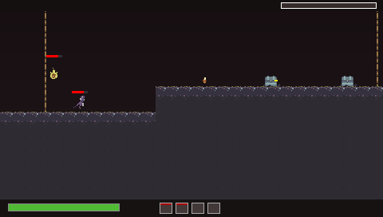

# Risk of Rain (2013) — Decompilación & Port a PlayStation Portable (PSP)

> [!IMPORTANT]
> ### ⚖️ Aviso Legal y Disclaimer (Non-Profit Educational Project)
> Este proyecto es un trabajo **sin fines de lucro desarrollado exclusivamente con propósitos educativos, de investigación y aprendizaje** sobre ingeniería inversa, arquitectura de videojuegos en GameMaker y programación de gráficos embebidos para hardware retro (MIPS Allegrex / Sony PSP).
>
> - **Risk of Rain** y todos sus personajes, diseños, arte, música y marcas asociadas son propiedad intelectual de **Hopoo Games** y **Gearbox Publishing**.
> - **No se distribuyen archivos comerciales ni activos propietarios con copyright** (binarios ejecutables originales, instaladores, música original en OGG, etc.).
> - Para obtener los recursos o jugar una versión completa, se requiere una copia legítima de *Risk of Rain* (disponible en Steam o GOG).
> - Este repositorio contiene el código decompilado en GML para estudio y la reimplementación limpia en lenguaje C para la consola PSP.

---

## 🎮 Acerca del Proyecto

Este repositorio contiene la ingeniería inversa y el port nativo en **C / PSPSDK** del aclamado juego *Risk of Rain* (v1.3.x, GameMaker Studio 1.4) para la consola **PlayStation Portable (PSP)** y su emulador **PPSSPP**.

El objetivo es lograr un port de alto rendimiento a 60 FPS aprovechando la GPU nativa de la PSP (`pspgu`), respetando las limitaciones estrictas de memoria (32 MB / 64 MB) mediante pools de memoria fijos y cero asignaciones dinámicas en el bucle principal.

---

## 📸 Captura de Pantalla Real (480 × 272)

Fotograma real generado por el motor de renderizado en resolución nativa de PSP:



---

## ✨ Características Implementadas

- **Generador Procedural de Mapas (`src/map.c`)**:
  - Recreación matemática de *Desolate Forest* (160 × 80 tiles / 2560 × 1280 px).
  - Tres tiers de terrazas, plataformas atravesables (one-way platforms) y red de cuerdas verticales escalables.
  - Regla de Risk of Rain: colocación procedural del Teletransportador garantizando distancia > 1,000 px de la cápsula de escape.
  - Generación de cofres ($25 y $50), barriles de oro, altares del azar y 64 puntos de spawn.
- **Sobreviviente Commando (`src/player.c`)**:
  - Movimiento, salto, escalada y orientación.
  - 4 Habilidades funcionales: *Double Tap* (Z), *Full Metal Jacket / Phase Round* (X), *Tactical Dive* con invulnerabilidad (C) y *Suppressive Fire* (V).
- **Director de Dificultad Dinámica (`src/director.c`)**:
  - Modos Drizzle, Rainstorm y Monsoon.
  - Escalado de vida y daño continuo con el tiempo.
  - Progresión por las 10 fases originales (*Very Easy* hasta *HAHAHAHA*).
  - Economía de créditos para spawn de oleadas de enemigos.
- **Motor de Renderizado para PSP (`psp/psp_video.c`)**:
  - Acelerado por GPU de PSP con la librería oficial `pspgu`.
  - Primitivas 2D de alta velocidad (`GU_SPRITES`) y doble búfer en VRAM (RGBA5551).
  - Atlas de texturas de 512×512 integrado directamente para ejecución 100% autónoma.
- **Host Simulator en PC (`src/render_host.c`)**:
  - Rasterizador por software con las mismas dimensiones para pruebas en Linux sin requerir emulador.

---

## 📁 Estructura del Repositorio

```
psp-game-port/
├── assets/         # Atlas optimizado para PSP (512x512) y capturas de prueba
├── docs/           # Documentación de ingeniería inversa y progreso
├── extracted/      # Código GML decompilado del juego original (3,447 scripts)
│   ├── code/       # Scripts y eventos GML decompilados de data.win
│   └── strings.txt # Textos y constantes extraídas
├── include/        # Encabezados C (game.h, map.h, player.h, render.h, sprites.h)
├── original/       # Directorio local para colocar data.win si se desea re-extraer
├── psp/            # Capa de hardware para PSP (pspgu, controles, Makefile PSP)
├── src/            # Implementación en C de la lógica del juego y renderizado
└── tools/          # Scripts de empaquetado de sprites y extracción
```

---

## 🛠️ Compilación e Instalación

### 1. Compilación para PC (Host Linux)
Para probar la lógica, el generador procedural y el renderizado directamente en Linux:
```bash
make clean && make
./bin/game_host
```

### 2. Compilación del binario de PSP (`EBOOT.PBP`)
Puedes compilar el binario oficial con Docker y la imagen oficial del PSPSDK:
```bash
docker run --rm -v $(pwd):/src -w /src/psp pspdev/pspdev make
```
El archivo ejecutable resultante estará en `psp/EBOOT.PBP`.

### 3. Instalación en Consola PSP o PPSSPP
- **PPSSPP**: Arrastra el archivo `EBOOT.PBP` a la ventana del emulador.
- **Consola PSP real (CFW)**: Copia la carpeta `RiskOfRain` que contiene el `EBOOT.PBP` en `ms0:/PSP/GAME/RiskOfRain/EBOOT.PBP`.

---

## 🕹️ Controles en PSP

| Botón PSP | Acción |
| :--- | :--- |
| **Stick / Cruceta** | Moverse y subir/bajar por cuerdas |
| **Cruz ($\times$)** | Saltar / Soltarse |
| **Cuadrado ($\square$)** | Habilidad 1: *Double Tap* |
| **Triángulo ($\triangle$)** | Habilidad 2: *Phase Round* |
| **Círculo ($\bigcirc$)** | Habilidad 3: *Tactical Dive* |
| **Gatillo R** | Habilidad 4: *Suppressive Fire* |
| **Abajo (D-Pad)** | Interactuar (Cofres / Teletransportador) |
| **Gatillo L** | Objeto de uso activo |
| **Start** | Pausa |
| **HOME** | Salir del juego |
